# Aula em motion · Novice N01 · Storyboard

Quadros capturados da própria cena (`node scripts/aula-motion/novice-01/render-aula.mjs --stills`): o storyboard
é exatamente o vídeo. Roteiro e falas em [`roteiro.md`](roteiro.md). Vídeo: [`aula.mp4`](aula.mp4)
(91 s, 1280x720, H.264 + AAC, 9,3 MB).

## Formato: sem personagem falando

- **Quadrinho animado nas cenas.** Três imagens paradas em 3D da Charlotte e do Igor ([`cenas/`](cenas)):
  a rua (os dois se encontram), o Igor acenando para a câmera e a despedida. Ninguém mexe a boca: a câmera
  anda devagar até quem fala, com luz de sol e poeira no ar.
- **Balões** abaixo do rosto (ou ao lado, quando há espaço), com o nome de quem fala. Cada palavra acende no
  momento em que é dita e a tradução aparece embaixo.
- **Explicação em tipografia animada** num fundo Tinta com manchas de cor e granulado. O inglês se monta no
  ritmo da voz e fica Volt, o português entra embaixo e a resposta vira pílula Volt. A Charlotte aparece no
  canto como narradora.
- **Hora do dia desenhada em código**: um céu que muda de manhã para tarde, noite e volta para a manhã.
- **Transições** por máscara circular com borda Volt e som de passagem. Toque suave em cada palavra da
  tipografia e dois tons na revelação da resposta certa. Ambiente leve de rua por baixo.
- Paleta Queizy, títulos em Bricolage Grotesque, logo branco no alto (preto no cartão final).

## Quadros

| # | Quadro | Momento | O que acontece |
|---|---|---|---|
| 1 |  | 0:00 | Título "Oi! Tudo bem?" palavra por palavra sobre a rua, com a cena escurecida. |
| 2 | 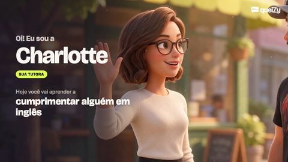 | 0:02 | A câmera chega na Charlotte acenando; ao lado entram "Oi! Eu sou a Charlotte", "sua tutora" e o objetivo da aula. |
| 3 | 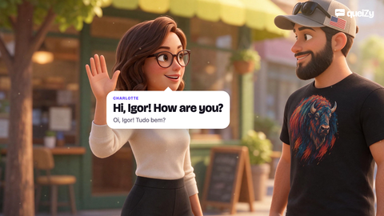 | 0:09 | Diálogo em balão: a câmera fica na Charlotte e cada palavra de "Hi, Igor! How are you?" acende quando é dita. |
| 4 |  | 0:11 | A câmera passa para o Igor: "I'm good, thanks! And you?", com a tradução embaixo. Depois, "I'm great!" nos dois. |
| 5 | 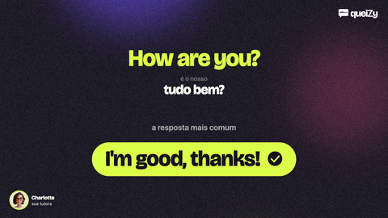 | 0:16 | Máscara Volt para a tipografia: "How are you?" é o nosso "tudo bem?"; a resposta vira a pílula Volt com visto. |
| 6 |  | 0:28 | **Pausa 1.** De volta à rua, no Igor: "Sua vez!", o balão "How are you?" e a pergunta com 3 opções. Depois da pausa, a certa fica verde. |
| 7 | 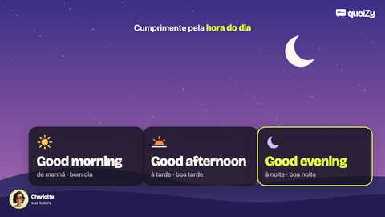 | 0:31 | Céu desenhado em código que muda com a fala: manhã, tarde e noite. Os cartões Good morning, Good afternoon e Good evening entram com sol, pôr do sol e lua. |
| 8 |  | 0:40 | Noite com estrelas: "Good night", "não é cumprimento" riscado e o carimbo "tchau!". |
| 9 |  | 0:50 | **Pausa 2.** O céu volta para a manhã, entra o relógio 9:00 e a pergunta. |
| 10 | 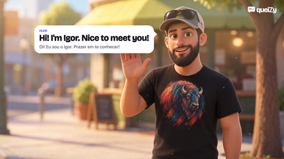 | 0:53 | Nova cena: o Igor acena para a câmera e se apresenta em balão ao lado: "Hi! I'm Igor. Nice to meet you!". |
| 11 | 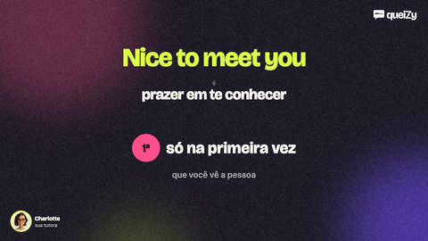 | 0:56 | Tipografia: "Nice to meet you" é "prazer em te conhecer", com o selo "1ª · só na primeira vez". |
| 12 | 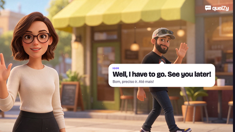 | 1:03 | Cena da despedida: o Igor vai embora acenando ("See you later!") e a Charlotte responde "See you!". |
| 13 | 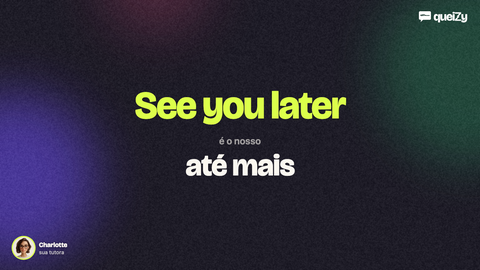 | 1:07 | Tipografia: "See you later" é o nosso "até mais". |
| 14 | 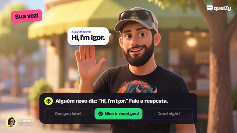 | 1:15 | **Pausa 3, de fala.** O Igor de novo para a câmera com o balão "Hi, I'm Igor."; a pergunta tem o microfone e as opções para quem não pode falar. |
| 15 | 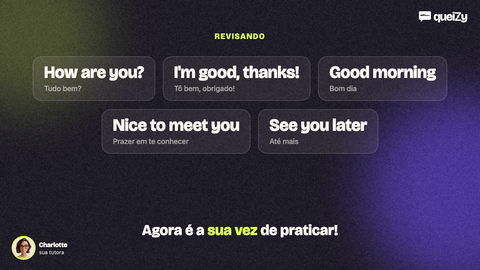 | 1:18 | Revisão: as 5 expressões entram e acendem em Volt quando são ditas; "Agora é a sua vez de praticar!". |
| 16 | 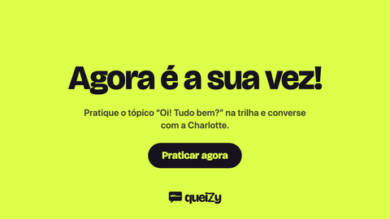 | 1:27 | Cartão final Volt: "Agora é a sua vez!", convite para praticar o tópico e o botão "Praticar agora". |

## Pausas no player

| Id | Para em | Tipo | Resposta |
|---|---|---|---|
| `cp1` | 29,0 s | toque (ou fala) | I'm good, thanks! |
| `cp2` | 50,9 s | toque (ou fala) | Good morning! |
| `cp3` | 75,9 s | fala (ou toque) | Nice to meet you! |

A pergunta aparece no vídeo enquanto a Charlotte termina a fala; o player para no ponto da pausa. Depois dela,
o vídeo mostra a resposta certa em verde por 1,6 s, então quem assiste o vídeo puro também vê a pergunta e a resposta.
