# Aula em motion · Novice N01 · Storyboard

Quadros capturados da própria cena final (`scripts/aula-motion/make-aula.mjs novice-01 --stills`): o storyboard
é exatamente o vídeo. Roteiro e falas em [`roteiro.md`](roteiro.md). Vídeo: [`aula.mp4`](aula.mp4)
(90 s, 720x1280, H.264 + AAC, 4,3 MB).

## Identidade visual

- Paleta Queizy: Papel no fundo das cenas de explicação, Volt nos círculos, destaques e cortinas, Violeta na rua
  e na cena do Igor, Tinta nos cartões de expressão, na pergunta e na revisão, Pink no "Sua vez" e no erro,
  Verde no acerto.
- Títulos, expressões e opções em Bricolage Grotesque (fonte do app); texto corrido na fonte do sistema.
- Personagens: poses animadas da Charlotte do próprio app (apresentando, acenando, comemorando, apontando) e o
  Igorfina de corpo inteiro. Quem fala dá um leve pulo no ritmo da voz; o balão mostra o nome e barrinhas rosa
  que acompanham o volume da fala.
- Balão de legenda embaixo, apontando para quem fala. Em português, o inglês ganha marca-texto Volt no
  momento em que é dito; nas falas em inglês, a tradução vem embaixo, menor.
- No alto, o logo e o contador "Aula 1" com 5 pontos que acendem a cada expressão aprendida.
- Transições em cortina Volt e Pink, com som de passagem. Na revelação da resposta certa, dois tons curtos.

## Quadros

| # | Quadro | Momento | O que acontece |
|---|---|---|---|
| 1 | 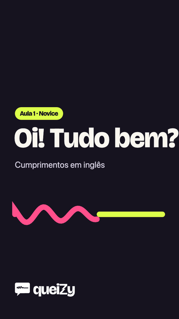 | 0:00 | Título letra a letra; a onda rosa da marca vira a linha Volt. |
| 2 |  | 0:03 | A Charlotte entra crescendo sobre o círculo Volt e se apresenta. |
| 3 |  | 0:11 | Rua. O Igor chega andando; a Charlotte acena: "Hi, Igor! How are you?". |
| 4 | 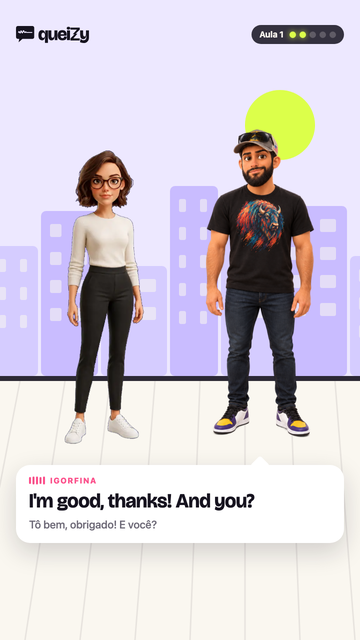 | 0:14 | O Igor responde "I'm good, thanks! And you?", com a tradução embaixo. |
| 5 | 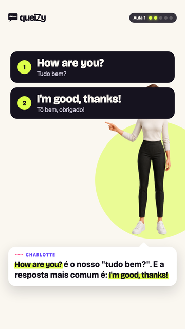 | 0:24 | Os cartões 1 e 2 entram quando a Charlotte diz cada expressão. |
| 6 | 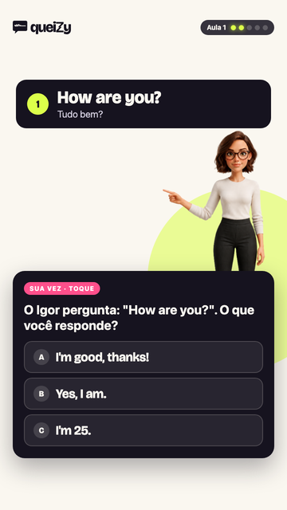 | 0:30 | **Pausa 1.** Sai o cartão da resposta e entra a pergunta com 3 opções. |
| 7 |  | 0:41 | Good morning, Good afternoon e Good evening entram com sol, pôr do sol e lua. |
| 8 | 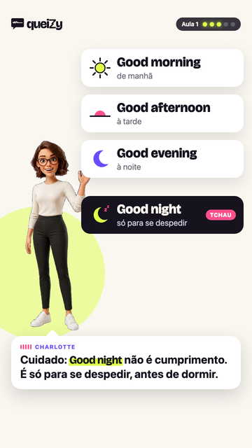 | 0:44 | O cartão escuro Good night com o selo "tchau". |
| 9 | 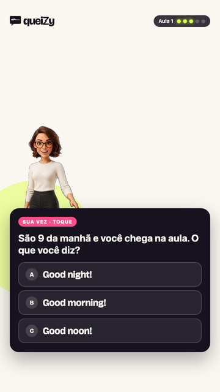 | 0:52 | **Pausa 2.** Os cartões saem e entra a pergunta das 9 da manhã. |
| 10 | 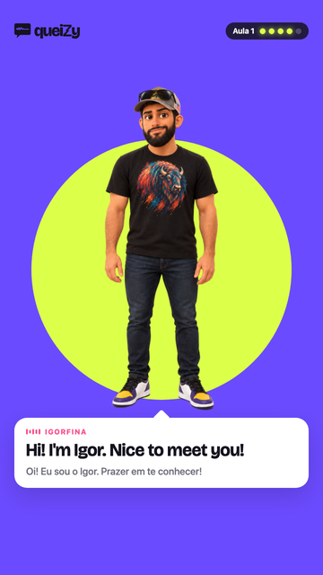 | 0:56 | O Igor se apresenta para a câmera: "Nice to meet you!". |
| 11 | 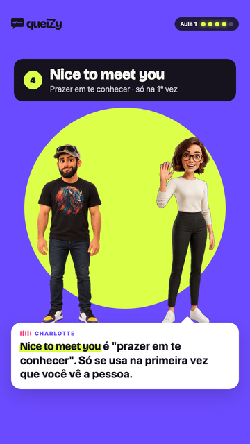 | 0:59 | O Igor vai para a esquerda, a Charlotte entra e explica; cartão 4. |
| 12 |  | 1:04 | "See you later!"; depois do "See you!" da Charlotte, o Igor sai andando. |
| 13 | 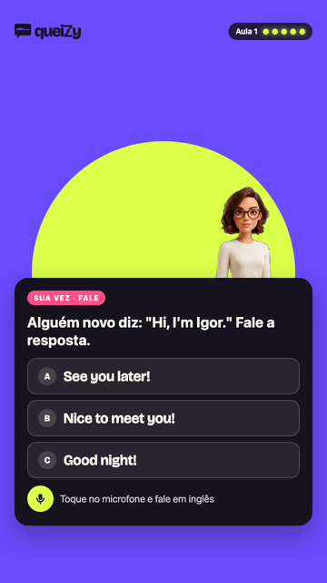 | 1:15 | **Pausa 3, de fala.** Pergunta com o microfone; as opções servem para quem não pode falar. |
| 14 | 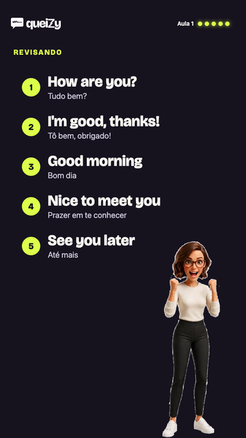 | 1:26 | Revisão: as 5 expressões entram enquanto são ditas; a Charlotte comemora. |
| 15 | 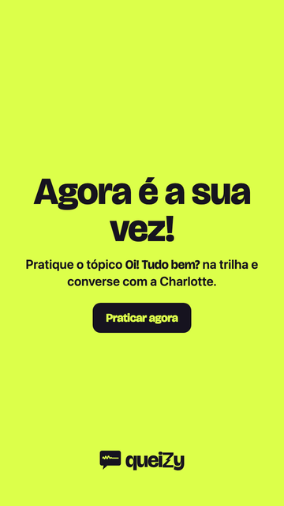 | 1:29 | Cartão final em Volt: "Agora é a sua vez!" e o convite para praticar o tópico. |

## Pausas no player

| Id | Para em | Tipo | Resposta |
|---|---|---|---|
| `cp1` | 0:30,2 | toque (ou fala) | I'm good, thanks! |
| `cp2` | 0:52,0 | toque (ou fala) | Good morning! |
| `cp3` | 1:14,8 | fala (ou toque) | Nice to meet you! |

Depois de cada pausa, o vídeo mostra a resposta certa em verde por 1,4 s. Quem assiste sem o player interativo
(vídeo puro) também vê a pergunta e a resposta.
