# Storyboard · PN01 "Oi!"

Quadros reais do vídeo (`render-aula.mjs --stills`), em `storyboard/`. Formato do piloto `novice-01`.

| Quadro | O que acontece |
|---|---|
| 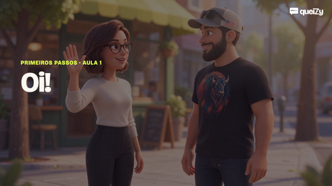 | Rua escurecida, "Primeiros passos · Aula 1" e o título **Oi!** |
| 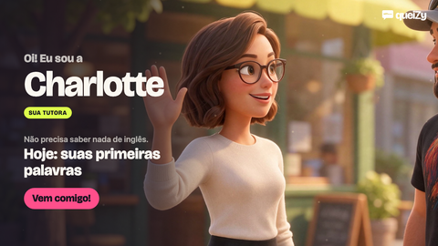 | A câmera chega na Charlotte; nome, "sua tutora", "Não precisa saber nada de inglês." e "Vem comigo!" entram no ritmo da fala |
| 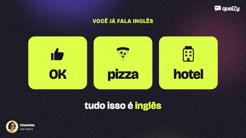 | Tipografia: OK, pizza e hotel caem um a um e acendem em Volt quando ditos |
| 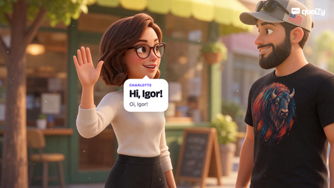 | Na rua: balão "Hi, Igor!" abaixo do rosto da Charlotte |
| 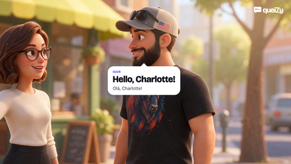 | A câmera vai até o Igor: "Hello, Charlotte!" |
| 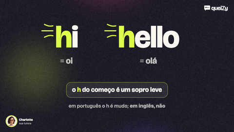 | hi = oi, hello = olá; no "sopro" o h fica Volt e as linhas de ar saem da letra; a dica entra embaixo. Na repetição ("Hi. Hello.") cada palavra dá um pulinho |
| 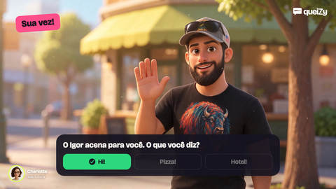 | Pausa 1: o Igor acena para a câmera. Hi! / Pizza! / Hotel! (a certa aparece depois da resposta) |
| 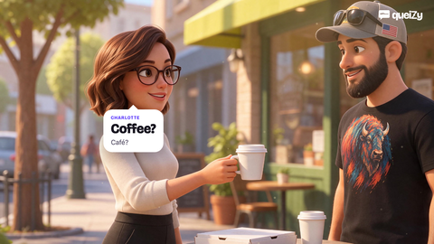 | Café (imagem nova): a Charlotte oferece, "Coffee?" |
| 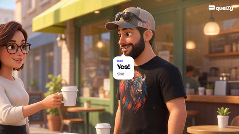 | O Igor: "Yes!" |
|  | Depois de "Pizza?", o Igor: "No!" |
| 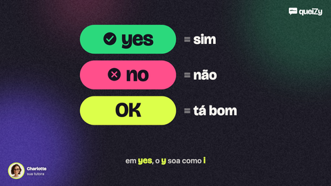 | Tipografia: yes (verde, visto) = sim, no (pink, X) = não, OK = tá bom; "em yes, o y soa como i" |
| 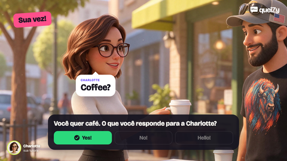 | Pausa 2: close na Charlotte com a xícara, balão "Coffee?". Yes! / No! / Hello! |
| 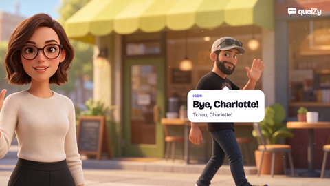 | Despedida: o Igor vai embora acenando, "Bye, Charlotte!"; a Charlotte responde "Bye, Igor!" |
| 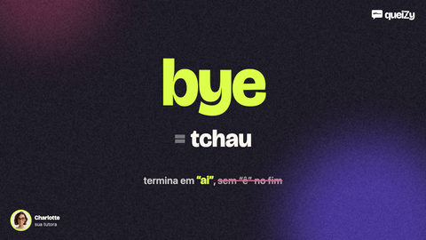 | Tipografia: bye = tchau; "termina em “ai”, sem “ê” no fim" |
| 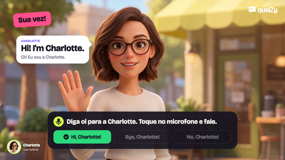 | Pausa 3 (fala): close na Charlotte, balão "Hi! I'm Charlotte." ao lado do rosto; o aluno fala |
| 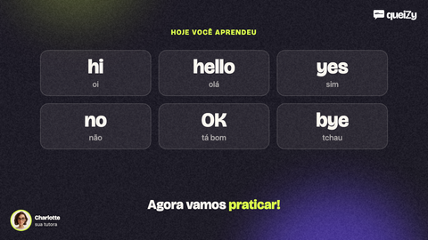 | Revisão: as 6 palavras acendem em Volt quando ditas |
| 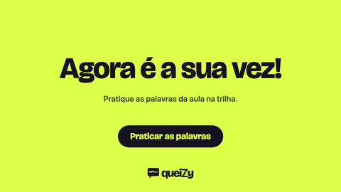 | Cartão final Volt: "Agora é a sua vez!" e "Praticar as palavras" |
